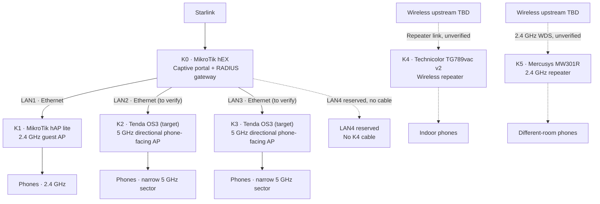
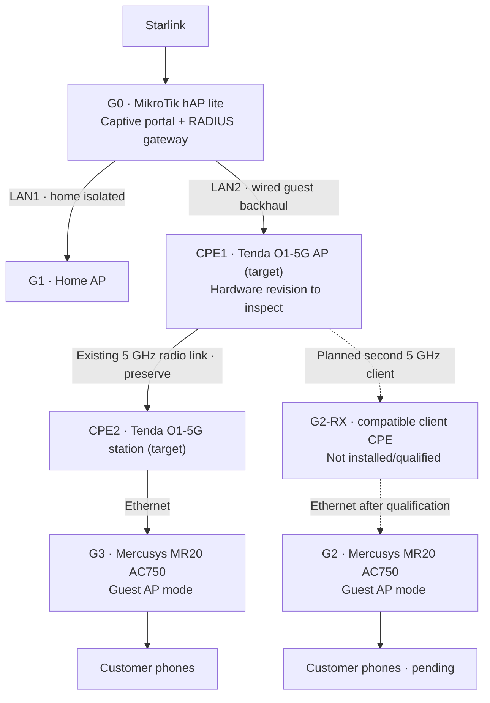

# PasoFi field architecture — updated 17 November 2026

**A design, not a verified network configuration.** Solid arrows indicate intended physical Ethernet connections as reported by the owner; dotted arrows indicate wireless links or intended repeaters. K4/K5 radio uplink source and all router firmware, RF, live NAS and cabling must still be inspected. Do not import historical hAP-lite gateway scripts onto the new K0 hEX.

## Kuwadzana — K0 gateway and directional/indoor extensions

**Important:** K2/K3 will use Tenda OS3 12 dBi **directional CPEs** after the physical exchange, not omnidirectional outdoor sector/mesh APs. Tenda specifies a roughly **30° beam** on both O1-5G and OS3. The advertised 1 km+ (O1-5G) or 5 km (OS3) describes a *CPE-to-CPE link* under suitable conditions, not the distance that a normal phone can reliably transmit back to a CPE. Test customer signal in both directions and actual HotSpot visibility across the planned 30° sectors.

**K4 and K5 have no Ethernet link to K0 LAN4.** They are owner-described wireless repeaters; their actual upstream AP, repeater/WDS firmware mode, transparent MAC/IPv4 forwarding and radio channel have not been verified. MW301R is 2.4 GHz only; TG789vac v2 may not offer compatible wireless repeater mode on every firmware. Do not enable an independent DHCP/NAT or uncontrolled bridge that bypasses the K0 HotSpot.

## Goromonzi — G0 gateway, home separate, CPE backhaul preserved

The MR20 supports **AP** and **Range Extender** modes; the latter does not prove the necessary transparent Layer 2 behavior for MikroTik HotSpot per-client accounting or that the OS3's existing CPE2 remains associated. Prefer a separately tested 5 GHz receiving CPE on G2 and an Ethernet-fed MR20. Do not change CPE1's radio mode while it is carrying G3 traffic without independent management/rollback.

## Should we swap the Tenda radios?

| Attribute | Tenda O1-5G (target Goromonzi bridge) | Tenda OS3 (target Kuwadzana K2/K3) |
| --- | --- | --- |
| Use case | Directional outdoor PtP/PtMP bridge; short directed phone-facing use *only after field tests* | Directional outdoor PtP/PtMP bridge |
| Advertised link reach | 1+ km **between compatible CPEs** | 5+ km **between compatible CPEs** |
| Antenna / horizontal width | 9 dBi / 30° | 12 dBi / 30° |
| Wired interface | 1 × 10/100 Mbps | 4 × 10/100 Mbps |
| Practical phone coverage | Narrow sector; phone transmit power usually limits far-end return path | Same narrow sector; 12 dBi does not make it omnidirectional |
| Current role | Owner-reported currently K2/K3; to become Goromonzi CPE1/CPE2 **after qualification** | Existing Goromonzi CPE1–CPE2 bridge; to become Kuwadzana K2/K3 **after a replacement link works** |

**Owner-selected assignment:** Put the two OS3 CPEs at **Kuwadzana K2/K3** and use the two O1-5G CPEs for the **Goromonzi CPE1/CPE2 bridge**. This is the **target, not a completed hardware migration**. Keep the live Goromonzi OS3 bridge online until an O1-5G replacement is proven at the actual distance, clear line of sight, capacity and encrypted configuration; if the link exceeds the O1-5G's viable range, retain OS3 for Goromonzi pending an alternative backhaul rather than creating an outage. G2 requires a third compatible client/receiver, or a separately verified equivalent; two O1-5G units alone provide only CPE1 and CPE2. OS3 gives K2/K3 a more directional 12 dBi link budget, **not 360° phone coverage**. For wider handset coverage, use true outdoor sector/omni APs.

**Operator checks before any swap:** measured CPE endpoints' separation, 5 GHz channel and spectrum, Fresnel clearance, receiver signal/dBm, throughput under simultaneous clients, local EIRP rules, MR20 firmware/mode, and baseline/restore of the existing OS3 pair. Compare line of sight and number of AP clients rather than headline range.

**Manufacturer sources:** [Tenda O1-5G technical page](https://www.tenda.cz/article/tenda-o1-5g-wireless-outdoor-cpe-5-ghz-9-dbi), [Tenda OS3 official specification](https://www.tendacn.com/cn/product/support/OS3), [Mercusys MR20 official modes](https://www.mercusys.com/en/product/wifi-router/mr20/v1/), [Mercusys MW301R V2 specification](https://www.mercusys.com/en/product/wifi-router/mw301r/v2/).

**Cutover dependency:** The Goromonzi OS3 CPE1–CPE2 bridge is still the reported existing link; do not move either unit to Kuwadzana until the O1-5G bridge is simultaneously proven and rollback is prepared. The two available O1-5G units are not enough to add a *third* G2 receiving radio.

## Customer acceptance (unchanged)

Only **K0** and **G0** should be registered as paid HotSpot NAS gateways. Guest APs, CPEs and repeaters must not provide an unmetered alternative route, independent NAT/DHCP or another RADIUS source. On a phone with mobile data off, prove HTTPS login, the real cash-sale voucher, authenticated RADIUS session, upload/download Interim/Stop accounting and quota disconnect on each physical path. Repeat after roaming among K1–K5 and G2/G3 (where installed); inspect per-client MAC/IP visibility especially through wireless repeater modes. A green CI check is **not** evidence that any radio path or cash collection is operational.
